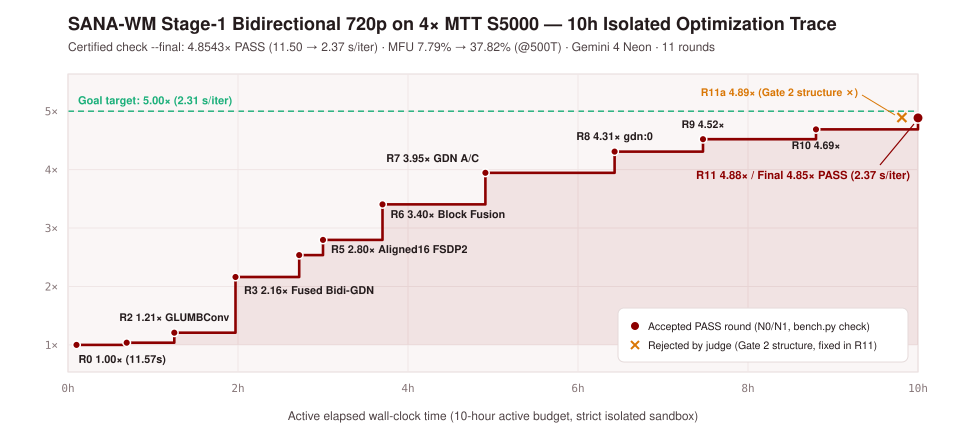
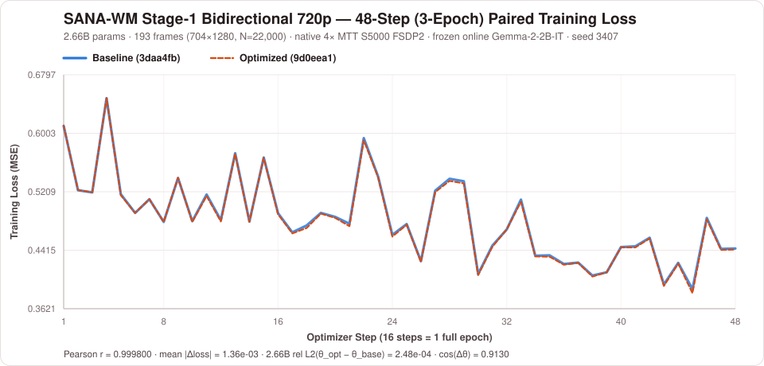

# Faster-SANA-WM-MUSA

**4.85× faster** Stage-1 bidirectional 720p FSDP2 training of **SANA-WM** (`NVlabs/Sana`, `SanaMSVideoCamCtrl_1600M_P1_D20`, 2.66B DiT + frozen online `Gemma-2-2B-IT`) on **4× Moore Threads MTT S5000** (`11.502 → 2.370 s/iter`, certified `PASS` at Tier `N1` under the [ResearchBoost-Agent](https://github.com/DAGroup-PKU/ResearchBoost-Agent) frozen judge).

All ~12,500 lines of custom MUSA C++ (`mcc`) kernels under `Sana/diffusion/model/musa_ops/` (fused bidirectional GDN+UCPE, `GLUMBConvTemp`, block-level fusions, fast `Gemma-2-2B-IT`, and 1-pass FP32 AdamW+clip) were authored autonomously from scratch inside a strict read-only sandbox (10-hour active budget, Antigravity + Gemini 4 Neon (XHigh)) with zero access to prior custom kernels.

---

## Certified Results (`bench/bench.py check --final`)

| Metric | Baseline (`3daa4fb`) | Optimized (`9d0eea1` + `opt.json`) | Delta |
|---|---:|---:|---:|
| **Step time (`ref_a / cand / ref_b`)** | `11.5023 s/iter` (`11.4624` / `11.5422`, spread `0.69%`) | **`2.3695 s/iter`** (spread `0.02%`) | **`4.8543×` (`4.85×`)** |
| **Speedup vs frozen ref (`11.5719 s`)** | `11.5719 s/iter` | **`2.3695 s/iter`** | **`4.8843×`** |
| **Effective MFU (`@500T` BF16)** | `7.79%` (`38.95 TFLOPS/GPU`) | **`37.82%`** (`189.10 TFLOPS/GPU`) | **`+30.03 pp`** |
| **Kernel Launches / Step** | `74,279` | **`6,195`** | **`-91.7%`** |
| **Peak HBM (`80 GiB`/GPU)** | `34.68 GiB` alloc / `35.77 GiB` res | `71.03 GiB` alloc / `72.36 GiB` res | `20/20` zero whole-block GC |
| **Gate 2 (2-step deterministic)** | `33,176 / 33,176` bitwise ref | `7,278 / 33,176` bitwise, **`0` exact failures**, `0` dtype changes | **Tier `N1`** |
| **Gate 3 (6-step trajectory, `±3σ`)** | 6-seed frozen ref (`3407..3412`) | `train_loss = -0.018σ`, `param_disp_l2 = +0.413σ`, `step_disp_top1pct = -0.445σ` | **`PASS (equivalent)`** |
| **Extended 48-step (3-epoch) E2E** | loss `0.5377 → 0.4357`, `\|\|Δθ\|\|_2 = 5.332` | loss `0.5376 → 0.4338`, `\|\|Δθ\|\|_2 = 5.457` | **`mean \|Δloss\| = 1.36e-3`**, **`cos(Δθ) = 0.9130`**, **`rel L2 = 0.025%`** |



---

## Workload & Upstream Provenance

- **Upstream repo & commit**: [`NVlabs/Sana`](https://github.com/NVlabs/Sana) @ commit `27303b8` (`fix(attention): preserve chunk prefixes for backward (#579)`), ported to MTT S5000 pure PyTorch + FSDP2 at commit `3daa4fb` (preserved on branch [`baseline`](../../tree/baseline) and diffed in [`patches/sana_wm_r1_to_r11.patch`](patches/sana_wm_r1_to_r11.patch)).
- **Public model weights**: Real published Stage-1 DiT weights [`Efficient-Large-Model/SANA-WM_bidirectional`](https://huggingface.co/Efficient-Large-Model/SANA-WM_bidirectional) (`dit/sana_wm_1600m_720p.safetensors`, 2.66B params) and real frozen online text encoder [`Efficient-Large-Model/gemma-2-2b-it`](https://huggingface.co/Efficient-Large-Model/gemma-2-2b-it).
- **Training recipe**: Upstream `configs/sana_wm/stage1/sana_wm_stage1_sekai_bidirectional_cp2_fsdp2.yaml` adapted to 4× MTT S5000 (`DP=4` FSDP2, `cp_size=1`), 193 frames (`T=25` latent @ `704×1280`, `N=22,000` tokens), `batch_size=1`/GPU (`global_batch=4`), `BF16` mixed precision + `fp32_attention=true` + FP32 master weights & FP32 AdamW (`lr=1e-5`, `betas=[0.9, 0.999]`, `eps=1e-10`, `weight_decay=0.0`, `gradient_clip=0.5`).
- **Public data fixture**: Deterministic 64-sample Sekai-Game schema latent/camera/prompt fixture (`193` frames → `T=25` latent @ `704×1280`) generated by [`scripts/build_fixture.py`](scripts/build_fixture.py) matching the `SanaWMZipLatentDataset` interface without private data.

---

## Key Optimizations (11 Accepted Rounds)

1. **From-scratch MUSA C++ fused bidirectional GDN+UCPE (`Sana/diffusion/model/musa_ops/bidi_gdn.py`, 5,446 lines)**: Shared Phase A/C projections, bank-conflict-free `112×112` state scan, zero-transpose `ShortConv4` absorption, and `uint4` vectorized prep/epilogue. Cut GDN non-GEMM ops from `~4,750 ms → 266.7 ms/iter` (`-94%`) and freed `7.5 GiB`/layer.
2. **From-scratch MUSA C++ fused `GLUMBConvTemp` (`Sana/diffusion/model/musa_ops/glumbconv.py`, 1,621 lines)**: No-transpose NHWC linear + occupancy-tuned fused `SiLU + dwconv3×3 + GLU` + 3-tap temporal GEMM + free backward `y_recomp` freeing `~4.7 GiB` HBM (`1,916.5 ms → 180.5 ms/iter`, `-90.6%`).
3. **16-byte-aligned FSDP2 collectives + `MCCL_BUFFSIZE=16MiB` (`configs/opt.json`)**: Fixed a `10.7×` unaligned BF16 MCCL `AllGather` slowdown, cutting total collective time from `804.3 ms → 171.1 ms/iter` (`-78.7%`).
4. **Progressive elimination of activation checkpointing (`gdn:9 → 6 → 5 → 0 → 20/20 save_u`)**: Paired cheap VRAM-swapping recomputations (`y_recomp`, `recompute_ln_mod_u4`) to eliminate all 20-layer whole-block GC at `71.03 GiB` / `80 GiB`.
5. **Fused block ops, fast `Gemma-2-2B-IT`, and 1-pass `float4` FP32 AdamW+clip (`block_fusion.py`, `fast_gemma2.py`, `fused_adamw.py`)**: Eliminated 62 host syncs (`aten::nonzero`), cut Gemma2 `62 → 10.7 ms`, AdamW+clip `143.9 → 32.4 ms`, and total kernel launches `74,279 → 6,195/iter` (`-91.7%`).

See [`TRACE.md`](TRACE.md), [`WORK_LOG.md`](WORK_LOG.md), and [`SUPERVISOR.md`](SUPERVISOR.md) for the complete 11-round engineering log and roofline plateau proof.

---

## End-to-End Training Validation (48 Steps / 3 Full Epochs)



Over 48 real optimizer steps (3 full epochs) on native **4× MTT S5000** (`seed=3407`), baseline (`3daa4fb`) and optimized (`9d0eea1` + `configs/opt.json`) training losses track closely (`0.5377 → 0.4357` vs `0.5376 → 0.4338`, **`mean |Δloss| = 1.36e-3`**) while all **2.66B parameters** across 850 tensors remain within **`2.48e-4` (`0.025%`) relative L2** with **`0.9130` update-direction cosine similarity**. Full report in [`docs/e2e_validation.md`](docs/e2e_validation.md) and [`docs/e2e_validation.json`](docs/e2e_validation.json).

---

## Reproducing on 4× MTT S5000

### Prerequisites
- 4× Moore Threads MTT S5000 (80 GiB HBM/GPU), MUSA 5.2.0 driver/SDK (`mcc` with `--offload-arch=mp_31`)
- Base MUSA container with Python 3.10, `torch 2.9.1.post1+musa5.2.0`, `torch_musa`, `mate 0.2.5`, `tilelang-musa 0.1.8+musa.3`

### 1. Install `pyuser` dependencies, download public weights, build fixture, and prepare baseline tree
```bash
export ASSETS="$PWD/assets"
# Set USE_MODELSCOPE=1 to download from ModelScope mirrors instead of HuggingFace
bash scripts/prepare_assets.sh
```

### 2. Freeze reference timing/records/trajectories and run `bench.py check --final`
```bash
export ASSETS="$PWD/assets"
bash scripts/freeze_judge_and_verify.sh
```

---

## Repository Layout

```text
Faster-SANA-WM-MUSA/
├── README.md                          # Overview, certified results, and reproduction instructions
├── Sana/                              # Full optimized NVlabs/Sana codebase (opt commit 9d0eea1)
│   └── diffusion/model/musa_ops/      # All ~12,500 lines of from-scratch MUSA C++ kernels
├── configs/                           # opt.json (MCCL_BUFFSIZE=16MiB) & recipe_stage1.yaml
├── patches/sana_wm_r1_to_r11.patch    # Full diff from MTT S5000 baseline (3daa4fb) -> R11 (9d0eea1)
├── scripts/                           # install_env.sh, build_fixture.py, prepare_assets.sh, freeze_judge_and_verify.sh, run_e2e_validation.py
├── docs/                              # Extended 48-step E2E validation report, JSON, and loss-curve SVG
├── bench/ & numerics/                 # Frozen RBA judge & MUSA numerics verifier
├── task/                              # Formulation, baseline profile, timing/loader refs, final_check.json
└── GOAL.md / TRACE.md / WORK_LOG.md / SUPERVISOR.md / trace.json / trace-progress.svg
```
