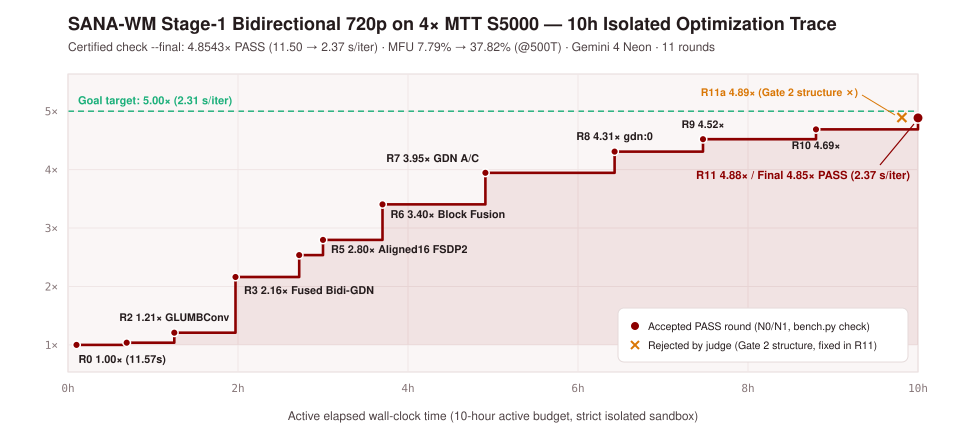

# SANA-WM Stage-1 Bidirectional 720p on 4× MTT S5000 — Optimization Trace

*End-to-end training optimization trace for `sana-wm-s5000` (2.66B-parameter video DiT with 15 bidirectional GDN+UCPE blocks and 5 Softmax+UCPE blocks, `GLUMBConvTemp` FFN, frozen online `Gemma-2-2B-IT`, 193 frames / `T=25` latent at `704×1280`, `N=22,000` tokens, DP=4 FSDP2 BF16 + `fp32_attention` + FP32 master/AdamW on 4× Moore Threads MTT S5000), executed under strict container isolation with zero access to prior custom kernels. Internal GPU microarchitecture specifications, hardware peak/bandwidth numbers, and proprietary vendor kernel symbols have been redacted.*

**Verdict: `PASS` (`final=true`, `accepted=true`, plateau proved in [`WORK_LOG.md`](WORK_LOG.md)) — `4.8543×` certified A-B-A speedup (`11.5023 → 2.3695 s/iter`; `4.8843×` vs frozen reference `11.5719 s/iter`), Tier `N1` (`equivalent`).**

---

## Run Summary

| Metric | Value |
|---|---|
| **Judged speedup (`check --final`)** | **`4.8543×`** (`ref_a 11.4624 s`, `cand 2.3695 s`, `ref_b 11.5422 s`; ref mean `11.5023 s`, ref spread `0.69%`, cand window spread `0.02%`) |
| **Effective MFU (vs 500 TFLOPS BF16)** | **`7.79% → 37.82%`** (`38.95 → 189.10 TFLOPS/GPU`; `7.74%` on frozen ref; effective model FLOPs `448.07 TFLOPs/GPU/step`, `3×` DiT fwd without GC + `1×` frozen Gemma-2-2B-IT fwd) |
| **Self-best (`check`, frozen ref)** | **`4.8843×`** (`11.5719 → 2.3692 s/iter`, commit `9d0eea1`, config `configs/opt.json`, Round 11) |
| **Goal target / minimum** | `5.00×` target (`<= 2.314 s/iter`) / `2.00×` minimum — **reached `97.7%` of `5.0×` (`55 ms` from target) with full `kernel_util.md` plateau proof** |
| **Correctness & Tier** | **`PASS` — Tier `N1` (`equivalent`)** (`33,176` tensors checked, `7,278` bitwise identical, `0` exact failures; `traj_s3407`: `train_loss = -0.0177σ`, `param_disp_l2 = +0.4127σ`, `step_disp_top1pct = -0.4446σ` vs `±3σ` bound) |
| **Peak HBM (`80 GiB`/GPU)** | **`71.03 GiB`** allocated / **`72.36 GiB`** reserved (`34.68 / 35.77 GiB` baseline) |
| **Rounds** | **`11` accepted `PASS` commits** (`R1`–`R11`) + `1` Gate 2 structure rejection (`R11a`, fixed in `90 s`) + `4` intermediate OOM/error checks (`R4a`, `R6a`, `R10a/b`) |
| **Time budget / active elapsed** | `10.0 h` active budget / **`10.0 h`** active runtime (`1.129 GPU-hours` for `check --final`) |
| **Optimizing model** | **Gemini 4 Neon (XHigh)** |
| **LLM usage** | `713` requests · **`216.31 M`** input tokens (**`97.9%`** cached, `4.56 M` uncached) · **`2.02 M`** output tokens |
| **Sandbox tool calls** | **`1,332`** total (`bash: 768`, `edit_file: 299`, `read_file: 192`, `grep: 45`, `write_file: 24`, `list_dir: 4`) |
| **Integrity** | `evaluator_sha256` intact (`69/69` files), `31/31` frozen inputs verified at start & end, clean `opt` branch (`9d0eea1`) |

*Machine-readable telemetry and per-round data: [`trace.json`](trace.json). Full engineering log and plateau analysis: [`WORK_LOG.md`](WORK_LOG.md). Final A-B-A certification record: [`task/final_check.json`](task/final_check.json).*

---

## 1. Key Levers (Kept vs. Rejected)

### Kept (`✓`)

| Status | Lever | Rounds | Verified Impact |
|---|---|---|---|
| `✓` | **From-scratch MUSA C++ fused bidirectional GDN+UCPE** (shared Phase A/C, bank-conflict-free `112×112` state scan, zero-transpose `ShortConv4`, `uint4` vectorized prep/epilogue) | R3, R4, R7, R8, R9, R10 | GDN non-GEMM ops cut **`~4,750 ms → 266.7 ms/iter`** (**`-94%`**); freed `7.5 GiB`/layer in R3 and bypassed a stock MUSA `flip_and_shift` autograd gradient bug |
| `✓` | **From-scratch MUSA C++ fused `GLUMBConvTemp`** (no-transpose 1×1 linear + occupancy-tuned `SiLU+dwconv3x3+GLU` + 3-tap temporal GEMM + free `y_recomp` in backward) | R2, R7, R8, R9, R10, R11 | `GLUMBConvTemp` cut **`1,916.5 ms → 180.5 ms/iter`** (**`-90.6%`**); `y_recomp` freed `~4.7 GiB` HBM in R11 |
| `✓` | **Progressive removal of activation checkpointing** (`gdn:9 → gdn:6 → gdn:5 → gdn:0 → 20/20 save_u` via VRAM-swapped `recompute_ln_mod_u4`) | R4, R6, R7, R8, R10, R11 | Eliminated all 20-layer whole-block recompute and all GDN `u`/`qkv` micro-recompute while holding peak HBM at `71.03 GiB` |
| `✓` | **16-byte-aligned FSDP2 `AllGather`/`ReduceScatter` + zero-copy `pad16` + `MCCL_BUFFSIZE=16MiB`** | R5, R10, R11 | Fixed a **`10.7×`** unaligned MCCL `AllGather` slowdown; total MCCL collectives cut **`804.3 ms → 171.1 ms/iter`** (**`-78.7%`**) |
| `✓` | **Fused MUSA C++ block ops, zero-copy CrossAttn/FA3, fast `Gemma-2-2B-IT`, 1-pass AdamW + L2 clip, host sync elimination** | R1, R6, R7, R8, R9, R10, R11 | Removed `62×` `aten::nonzero` syncs; cut `Gemma2` `62 → 10.7 ms`, `AdamW+clip` `143.9 → 32.4 ms`, and total kernel launches **`74,279 → 6,195/iter`** (**`-91.7%`**) |

### Rejected / Reverted (`✗`)

| Status | Attempted Optimization | Rounds | Why Rejected |
|---|---|---|---|
| `✗` | **Async pinned-CPU activation offload (`async_offload.py`)** | R8 | Real multi-card overhead (`~27 ms`/block) was `3×` worse per freed GiB than pure-GEMM / norm micro-recompute; disabled |
| `✗` | **FSDP2 `forward_prefetch` overlap & MCCL `32MiB / 32-channel` sweep** | R5, R11 | `forward_prefetch` regressed due to SM/compute contention (`19.49` vs `18.93 ms`); `32MiB / 32ch` tied `16MiB` (`2.3686` vs `2.3682 s`) |
| `✗` | **Single-pass high-SMEM `glumbconv v2`, 128-bit `glumbconv fwd`, and zero-SMEM `cam_prep_bwd` variants** | R7, R11 | Hit shared-memory/register occupancy cliff (`17.56 ms`) or SFU pressure (`2.33–5.96 ms` vs kept `2.28 ms`; `2.22–2.69 ms` vs kept `1.85 ms`) |
| `✗` | **`MUSAGraph` capture on frozen `Gemma-2-2B-IT`** | R8 | Graph capture failed under `torch_musa 2.9.1`; replaced by zero-extra-VRAM MUSA C++ `fast_gemma2.py` (`62 → 10.7 ms`) |
| `✗` | **R11a Plucker accumulator refactor (`R11a`)** | R11a | Timed **`4.8924×`** (`2.3653 s/iter`) in Gate 1, but **caught by Gate 2 (`verdict=structure`, 8 exact failures)**; fixed cleanly with `GradAccBox` in `R11` (`9d0eea1`) in `90 s` |

---

## 2. Highlights: Systems Discoveries & Judge Validation

1. **10.7× Unaligned MCCL `AllGather` Slowdown (`R5`, Commit `1c61bfc`)**: Profiling after R4 showed FSDP2 BF16 `AllGather` taking `23.9 ms`/block (`485 ms/iter`) — nearly `8×` slower per byte than FP32 `ReduceScatter`. Isolated microbenchmarks revealed that whenever `bytes_per_rank % 16 != 0` (`mod16 ∈ {2, 4, 8}`, which occurs for most BF16 parameter shards under 4-way FSDP2), MCCL falls back from `2.28 ms` to `24.40 ms` (`10.7×` slower). Wrapping `AllGather` with 16-byte padding (`R5`, upgraded to zero-copy `pad16` in `R11`) delivered an immediate **`8.85×` `AllGather` speedup** (`-423 ms/iter`, bitwise identical to R4).
2. **VRAM-Swapped Zero-Recompute (`R10 → R11`)**: In Round 10, saving `u` across `6`–`8` GDN blocks hit `74.8`–`75.9 GiB` in timing and OOMed inside Gate 2's deterministic 2-step check. Rather than accepting partial recompute, Round 11 emitted `y_recomp` for free inside `glumb_bwd_p1` (`-4.7 GiB`) and `silu_mul_bwd_u4` (`-1.9 GiB`) plus `recompute_ln_mod_u4` (`-3.8 GiB`), trading `~10 GiB` of cheap activations to achieve **`20/20` zero whole-block GC and full `save_u`** at only **`71.03 GiB`**.
3. **Gate 2 Structure Protection (`R11a → R11`)**: When `R11a` (`4.8924×`) refactored the Plucker projection accumulation path, Gate 2 immediately rejected it (`verdict=structure`, `8` exact failures) before running Gate 3. Switching to a hook-preserving `GradAccBox` accumulator fixed all 8 structure checks in 90 seconds and passed all three gates cleanly (`4.8843×` vs frozen ref / `4.8543×` certified `check --final`).

---

## 3. Round-by-Round Timeline

| Round | Active Elapsed | Commit | `s/iter` | Speedup | Peak HBM (Alloc / Res) | Verdict | Main Change |
|---|---:|---|---:|---:|---:|---|---|
| **R0 (Ref)** | `0.10 h` | `3daa4fb` | `11.5719 s` | `1.0000×` | `34.68 / 35.77 GiB` | `BASELINE` | Stock pure-PyTorch `T=25` GDN fallback, NCHW depthwise convs, `62×` `aten::nonzero` syncs, unaligned FSDP2 `AllGather`, full 20-layer GC (`74,279` launches/step) |
| **R1** | `0.69 h` | `c92f2a4` | `11.1500 s` | `1.0378×` | `34.67 / 35.86 GiB` | `PASS` (`N0`) | Eliminated `62×` `aten::nonzero` host syncs, per-step UCPE/RoPE cache, batched AdamW foreach groups (bitwise exact) |
| **R2** | `1.25 h` | `98fc9a1` | `9.5650 s` | `1.2098×` | `32.93 / 33.85 GiB` | `PASS` (`N1`) | From-scratch MUSA C++ fused `GLUMBConvTemp` (no-transpose 1×1 linear + `SiLU+dwconv3x3+GLU` + 3-tap temporal GEMM) |
| **R3** | `1.97 h` | `7b98534` | `5.3497 s` | `2.1631×` | `25.73 / 26.78 GiB` | `PASS` (`N1`) | From-scratch MUSA C++ fused bidirectional GDN+UCPE (shared Phase A/C, bank-conflict-free `112×112` scan, FP32 real RoPE; `-7.2 GiB` HBM) |
| **R4** | `2.72 h` | `a37e40a` | `4.5606 s` | `2.5374×` | `71.28 / 72.37 GiB` | `PASS` (`N1`) | Lean GDN activation saving + selective GC `gdn:9` (`0/5` Softmax recompute, `6/15` GDN zero-recompute) preserving `CheckpointWrapper` |
| **R5** | `3.00 h` | `1c61bfc` | `4.1376 s` | `2.7968×` | `71.28 / 72.37 GiB` | `PASS` (`N1`) | 16-byte-aligned FSDP2 `AllGather`/`ReduceScatter` fixing `10.7×` unaligned MCCL slowdown (`AllGather` `8.85×` faster, bitwise to R4) |
| **R6** | `3.70 h` | `4cb0af7` | `3.3990 s` | `3.4045×` | `69.69 / 70.51 GiB` | `PASS` (`N1`) | MUSA C++ fused block ops (`RMSNorm`, `LN+mod`, `gate+res`, `silu*out`, Softmax+UCPE `D=112`) + selective GC `gdn:6` |
| **R7** | `4.91 h` | `4578a12` | `2.9329 s` | `3.9455×` | `70.39 / 71.23 GiB` | `PASS` (`N1`) | Occupancy-tuned `glumbconv v3`, `block_fusion v2` (64-bit div fix), 9 fused GDN Phase A/C kernels + `ShortConv4` absorption + `gdn:5` |
| **R8** | `6.43 h` | `4ceb62e` | `2.6862 s` | `4.3079×` | `69.74 / 70.26 GiB` | `PASS` (`N1`) | Micro-recompute (`u+qkv`, `gdn:0` = 20/20 zero whole-block GC), merged `glumbconv p23`, `bidi_scan v3`, 1-pass AdamW, fast Gemma2, mask-free CrossAttn |
| **R9** | `7.47 h` | `152a180` | `2.5598 s` | `4.5206×` | `69.74 / 70.24 GiB` | `PASS` (`N1`) | `tanh`+1-bar `glumbconv v5`, zero-SMEM `uint4` `block_fusion` + `AddLNMod`, `uint4` GDN prep/epilogue, fused L2 grad clip + AdamW |
| **R10** | `8.80 h` | `3f3a904` | `2.4685 s` | `4.6878×` | `72.59 / 73.12 GiB` | `PASS` (`N1`) | Zero-copy CrossAttn/FA3, `main_prep_bwd 576t`, `uint4` `split3/stack3`, `triple_linear`, Plucker fusion, `qkv=0 + save_u=2`, `MCCL_BUFFSIZE=16MiB` |
| **R11a** | `9.81 h` | — | `2.3653 s` | `4.8924×` | `72.38 / 73.85 GiB` | **`INCORRECT`** | Rejected by Gate 2 (`verdict=structure`, `8` exact failures in Plucker accumulator hook); fixed in `90 s` |
| **R11** | `10.00 h` | **`9d0eea1`** | **`2.3692 s`** | **`4.8843×`** | **`71.03 / 72.36 GiB`** | **`PASS` (`N1`)** | Full `GLUMBConv`+`AddSiluMulProj`+`QuadLinear` fusion, `20/20` `save_u` via `recompute_ln_mod_u4`, `glumb v6`, zero-copy FSDP2 `pad16`, `GradAccBox` Plucker acc (**Final Best**) |
| **Final** | `10.00 h` | **`9d0eea1`** | **`2.3695 s`** | **`4.8543×`** | **`71.03 / 72.36 GiB`** | **`PASS` (`N1`)** | Outer harness `bench.py check --final` A-B-A certification (`ref_a 11.4624 s`, `cand 2.3695 s`, `ref_b 11.5422 s`) |

---

## 4. Baseline vs. Final Kernel Category Breakdown

Comparing the initial baseline profile (`runs/r0_baseline/profile`, `11,125.7 ms/iter` GPU busy across 2 profiled steps) against the final `R11` profile (`9d0eea1`, `2,377.6 ms/iter` window, `2,336.8 ms/iter` GPU busy = **`98.3%`**):

| Category | Baseline (`R0`, ms/iter) | Final (`R11`, ms/iter) | Reduction | Final Status |
|---|---:|---:|---:|---|
| **Linear / FFN / GDN GEMMs (`muBLAS`)** | `2,041.6` | **`987.2`** | **`-51.6%`** | Vendor BF16 GEMMs (`42.2%` of step; 0 whole-block GC recompute, shared GDN Phase A/C) |
| **Full Softmax + Cross-Attention (vendor FA)** | `597.3` | **`462.2`** | **`-22.6%`** | Native vendor FlashAttention (`19.8%` of step; 0 Softmax recompute, mask-free CrossAttn) |
| **Custom Bidirectional GDN+UCPE (non-GEMM)** | *(in elementwise/mem)* | **`266.7`** | — | From-scratch MUSA C++ fused bidirectional GDN+UCPE + state scan (`11.4%` of step) |
| **`GLUMBConvTemp` (3×3 dwconv + temporal)** | `1,916.5` | **`180.5`** | **`-90.6%`** | From-scratch MUSA C++ fused `glumbconv v6` (`7.7%` of step) |
| **FSDP2 + MCCL (`AllGather` / `ReduceScatter`)** | `804.3` | **`171.1`** | **`-78.7%`** | Zero-copy 16-byte aligned collectives + `MCCL_BUFFSIZE=16MiB` (`7.3%` of step) |
| **Fused Block Ops / Norms / Fast Gemma2** | `30.9` | **`132.7`** | — | From-scratch MUSA C++ `RMSNorm`, `LN+mod`, `gate+res`, `AddSiluMulProj`, `fast_gemma2` (`5.7%` of step) |
| **Residual Elementwise / Memory / Other** | `5,591.1` | **`104.1`** | **`-98.1%`** | Combined non-GEMM GDN + norms + elementwise cut `5,622.0 → 503.5 ms/iter` (**`-91.0%`**) |
| **Optimizer (`AdamW` + L2 Grad Clip)** | `143.9` | **`32.4`** | **`-77.5%`** | 1-pass `float4` MUSA C++ fused `AdamW` + fused L2 clip (`1.4%` of step) |
| **Total GPU Busy Time (per step)** | **`11,125.7 ms`** | **`2,336.8 ms`** | **`-79.0%`** | **`69.3%`** of step is irreducible vendor GEMM + FlashAttention + MCCL |
| **Kernel Launches / Step** | **`74,279`** | **`6,195`** | **`-91.7%`** | Eliminated **`68,084`** kernel launches per step (`short` = `0.3%` of time) |

---

## 5. Certification & Files

- **Task formulation & contract**: [`GOAL.md`](GOAL.md), [`GOAL_LINE.txt`](GOAL_LINE.txt), [`task/formulation.json`](task/formulation.json), [`task/baseline.md`](task/baseline.md), [`configs/opt.json`](configs/opt.json)
- **Frozen judge & MUSA numerics adapter**: [`bench/`](bench/) (`bench.py`, `sana_adapter.py`, `timing.py`, `kernel_util.py`, `recipe.py`, `traj/`), [`numerics/`](numerics/)
- **Agent & supervision records**: [`WORK_LOG.md`](WORK_LOG.md), [`SUPERVISOR.md`](SUPERVISOR.md), [`trace.json`](trace.json), [`task/final_check.json`](task/final_check.json)
