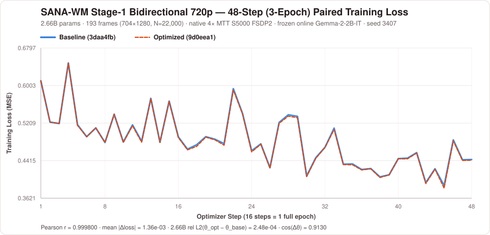

# End-to-End Training Validation (`SANA-WM Stage-1 Bidirectional 720p`)

Beyond the frozen judge's 2-step bitwise check (Gate 2) and 6-step paired deterministic trajectory gate (Gate 3), we ran a **48-step (3 full epochs)** paired real training comparison between the unmodified MTT S5000 baseline (`3daa4fb`) and the final R11 optimized candidate (`9d0eea1` + `configs/opt.json` with `MCCL_BUFFSIZE=16777216`) on the **native 4× MTT S5000** (`DP=4` FSDP2) topology.

## Configuration

| Item | Setting |
|---|---|
| **Baseline commit** | `3daa4fb` (unmodified MTT S5000 port of `NVlabs/Sana @ 27303b8`) |
| **Optimized commit** | `9d0eea1` + `configs/opt.json` (`MCCL_BUFFSIZE=16777216`) |
| **Model & shape** | `SanaMSVideoCamCtrl_1600M_P1_D20` (2,661,800,448 trainable params across 850 tensors: 15 bidirectional GDN+UCPE + 5 Softmax+UCPE blocks, `GLUMBConvTemp` FFN, real published `sana_wm_1600m_720p.safetensors` weights + frozen online `gemma-2-2b-it`), 193 frames (`T=25` latent, `704×1280`, `N=22,000` tokens) |
| **Precision** | BF16 mixed precision + `fp32_attention=true` + FP32 master weights & FP32 AdamW (`lr=1e-5`, `betas=[0.9, 0.999]`, `eps=1e-10`, `weight_decay=0.0`, `gradient_clip=0.5`) |
| **Topology** | **4× MTT S5000** (`DP=4` FSDP2, `batch_size=1/GPU`, `global_batch=4`, identical to benchmark) |
| **Horizon** | **48 optimizer steps** (3 full epochs over the 64-sample Sekai-Game fixture; 8× longer than Gate 3), `seed=3407` |
| **Checkpoint parity** | Full unsharded FP32 state dict gathered across all 850 trainable tensors (`2.66B` params) at step 0 and step 48 |

## Loss Curve Overlay

## Summary Metrics

| Metric | Baseline (`3daa4fb`) | Optimized (`9d0eea1`) | Comparison |
|---|---:|---:|---:|
| **Mean loss (steps 1–8)** | `0.537720` | `0.537598` | `-1.22e-4` (`-0.023%`) |
| **Mean loss (steps 41–48)** | **`0.435730`** (`-19.0%`) | **`0.433777`** (`-19.3%`) | **`-1.95e-3` (`-0.45%`)** |
| **Per-step `|Δloss|` across all 48 steps** | — | — | **mean `1.36e-3`** (`0.29%` of scale), max `5.37e-3` |
| **2.66B parameter displacement `\|\|θ_48 − θ_0\|\|_2`** | `5.3321` | `5.4566` | `+2.33%` |
| **Final weight rel L2 diff `\|\|θ_48^opt − θ_48^base\|\|_2 / \|\|θ_48^base\|\|_2`** | — | — | **`2.48e-4` (`0.025%`)** |
| **Global 2.66B update cosine similarity `cos(Δθ_opt, Δθ_base)`** | — | — | **`0.9130`** |
| **Steady step time (4× S5000, `num_workers=0`)** | `11.2133 s` | `2.3655 s` | **`4.74×`** (certified `num_workers=2` A-B-A: **`4.85×`**) |
| **Peak HBM (alloc / reserved, 4× S5000)** | `34.68 / 35.82 GiB` | `71.03 / 72.36 GiB` | fits in 80 GiB (`20/20` zero-recompute) |

Across 48 real optimizer steps (3 full epochs) on native 4× MTT S5000, both arms reduce training loss by `19.0%–19.3%` along tightly matched trajectories (`mean |Δloss| = 1.36e-3`), agree to `0.025%` relative L2 across all `2.66B` trained parameters, and achieve **`0.9130` update-direction cosine similarity** under non-deterministic fast FlashAttention + BF16 AdamW with `eps=1e-10`.

Full machine-readable per-step logs and 2.66B checkpoint metrics are stored in [`e2e_validation.json`](e2e_validation.json), and the exact driver script is in [`scripts/run_e2e_validation.py`](../scripts/run_e2e_validation.py).
